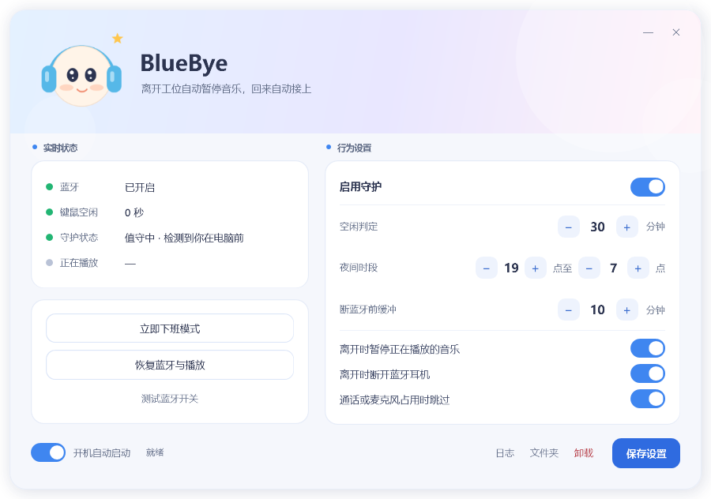

# BlueBye

[简体中文](README.md) · **English**



> Pause whatever is playing and switch the Bluetooth radio off when you really leave your desk — then put both back the moment you touch the keyboard again. Windows 10/11, plain PowerShell + WPF, zero third-party dependencies.

**The problem it solves:** you go home, the headphones stay connected to the PC and the music keeps playing. Players hold a "do not sleep" request, so the machine never idles, the headphones keep decoding / amplifying / running ANC all night, and the next morning the battery is flat.

BlueBye handles exactly that: when the desk is unattended it pauses the media and cuts the Bluetooth link (the headphones then power themselves off), and when you sit down again everything comes back automatically.

---

## Quick start

1. Open [Releases](https://github.com/lingfeb/BlueBye/releases/latest) and download **`BlueBye-Setup.exe`**
2. Double-click it, wait for the progress bar (about 5 seconds), then answer "Yes" to open the settings window
3. A **BlueBye** icon appears on your desktop and the guard is already running in the background

No administrator rights, no drivers, no services. To install from source instead:

```powershell
powershell -NoProfile -ExecutionPolicy Bypass -File install.ps1
```

Uninstall: the "卸载" button in the bottom-right corner, or `%LOCALAPPDATA%\BlueBye\uninstall.ps1`.

---

## Requirements

- Windows 10 / 11 (uses `Windows.Devices.Radios` and the system media session API; 1809+ is fine)
- PowerShell 5.1 (built into Windows)
- .NET Framework 4.x (used at install time to compile the windowless supervisor)

No administrator rights are needed: the installer only writes to `%LOCALAPPDATA%`, your own scheduled tasks and the desktop shortcut.

## Project structure

| Path | What it is |
| --- | --- |
| `bluebye-lib.ps1` | Engine: config, idle detection, WinRT Bluetooth, media sessions, state machine, host loop |
| `bluebye.ps1` | CLI entry point (`Host` / `Tick` / `Status` / `Night` / `Restore` / `Resume` / `Probe` / `Test` / `Ensure`) |
| `bluebye-ui.ps1` | WPF settings window: frameless rounded window, light cards, chibi mascot |
| `install.ps1` | Install: compiles the supervisor, draws the icon and mascot, registers both tasks, creates the desktop shortcut |
| `uninstall.ps1` | Uninstall: stops the tasks, removes the shortcut and the program folder |
| `make-mascot.ps1` | Draws the mascot with GDI+ (generated automatically at install time) |
| `dev/` | Developer helpers: `check.ps1` (AST parse check), `e2e-test.ps1` (end-to-end), `inspect-ui.ps1` (self-test render), `set-bom.ps1` (UTF-8 BOM fixer) |
| `docs/` | Screenshot |

## What gets installed

| Location | Content |
| --- | --- |
| `%LOCALAPPDATA%\BlueBye` | Program folder (scripts, config, logs) |
| Desktop shortcut "BlueBye" | Opens the settings window |
| `BlueByeSupervisor.exe` | Console-less supervisor: runs the PowerShell host and restarts it within 5 s if it exits |
| Scheduled task `BlueBye-Host` | Starts the supervisor at logon (hidden, no console window) |
| Scheduled task `BlueBye-Watchdog` | Every 20 minutes checks "process alive **and** heartbeat fresh"; restarts if either fails |

There are two layers in the background: the supervisor exe (no console, so it cannot be killed by console-control events) and the PowerShell host that ticks every 10 seconds and writes a heartbeat. If the heartbeat is older than three ticks the watchdog force-restarts it — you never get a "process is there but actually hung" situation.

---

## How it decides you left

**The only signal is keyboard/mouse idle time** — not your clock-in time:

1. the current time is inside the night window (default 19:00 → 07:00 next day);
2. keyboard/mouse idle reached the idle threshold (default 30 minutes);
3. there is no call in progress (a non-pausable media session, or the microphone is in use → skip);
4. no Bluetooth keyboard/mouse is connected (so it never cuts off your input devices).

When all of that holds:

- **step 1** — pause the players that are actually playing (QQ Music, Chrome, …) through the system media session, so nothing that was paused gets started;
- **step 2** — wait for the "before cutting Bluetooth" grace period (default 10 minutes). This is your undo window: if you were just watching a 30-minute video without touching the mouse, the pause itself is the hint — move the mouse and everything continues;
- **step 3** — switch the Bluetooth radio off, the headphones see the disconnect and power themselves off, and the night costs no battery.

Back at the desk: any input → Bluetooth is back within 10 seconds and the headphones reconnect.

> Only players that BlueBye paused itself are resumed; tabs you paused by hand are left alone.

---

## The settings window

Double-click "BlueBye" on the desktop. The window is light and friendly: a gradient header with a chibi mascot wearing Bluetooth headphones, then two white cards ("live status" and "behaviour").

- **Live status** — Bluetooth state, keyboard/mouse idle time, what the guard is doing, what is playing (blue / green / amber / red status dots)
- **Idle threshold** — how many minutes without input counts as "away" (stepper)
- **Night window** — only act between these hours (prevents false positives during a lunch break; equal values mean "never")
- **Grace before Bluetooth off** — how long to wait after pausing
- **Toggles** — pause media when away / cut Bluetooth when away / skip during calls or mic use / enable the guard
- **Leave now** — pause and cut Bluetooth immediately
- **Restore Bluetooth & playback** — turn the radio back on and resume
- **Test Bluetooth** — really switch it off and back on (~5 s) to verify the chain
- **Start with Windows** — enables or disables both scheduled tasks

The window is frameless: drag it by the header, minimise/close in the top-right corner. Tab shows a blue focus ring.

Settings are applied within 40 seconds (the host re-reads the config every 30 s, plus at most one 10 s tick).

---

## Configuration file

`%LOCALAPPDATA%\BlueBye\config.json`

| Key | Default | Meaning |
| --- | --- | --- |
| `Enabled` | `true` | Master switch; when `false` it only reports status |
| `NightStartHour` | `19` | Night window start hour |
| `NightEndHour` | `7` | Night window end hour (may wrap past midnight) |
| `IdleMinutes` | `30` | Minutes of input idle that count as "away" |
| `RadioOffDelayMinutes` | `10` | Wait after pausing before cutting Bluetooth; `0` = immediately |
| `RestoreIdleSeconds` | `60` | Idle below this means "the user is back" |
| `PauseMedia` | `true` | Pause playback when away |
| `TurnOffBluetooth` | `true` | Switch the Bluetooth radio off when away |
| `SkipOnCallSession` | `true` | Skip when a non-pausable (call) media session exists |
| `SkipWhenMicInUse` | `true` | Skip while the microphone is in use |
| `TickSeconds` | `10` | How often the host checks |
| `DebugLog` | `false` | Log every check (for troubleshooting) |

Save the file and it takes effect; no restart needed.

---

## Command line (optional)

```powershell
$exe = "$env:LOCALAPPDATA\BlueBye\bluebye.ps1"
powershell -NoProfile -ExecutionPolicy Bypass -File $exe -Mode Status    # state + recent log
powershell -NoProfile -ExecutionPolicy Bypass -File $exe -Mode Probe     # radio access, sessions, mic, ...
powershell -NoProfile -ExecutionPolicy Bypass -File $exe -Mode Night     # leave now
powershell -NoProfile -ExecutionPolicy Bypass -File $exe -Mode Restore   # turn Bluetooth back on
powershell -NoProfile -ExecutionPolicy Bypass -File $exe -Mode Resume    # resume what we paused
powershell -NoProfile -ExecutionPolicy Bypass -File $exe -Mode Ensure    # start the host if it is down
```

Log: `%LOCALAPPDATA%\BlueBye\bluebye.log` (rotates at 1 MB; the UI can open it for you).

---

## Uninstall

The "卸载" button in the bottom-right corner of the window, or:

```powershell
powershell -NoProfile -ExecutionPolicy Bypass -File "$env:LOCALAPPDATA\BlueBye\uninstall.ps1"
```

It stops the guard, removes both scheduled tasks, the desktop shortcut and the program folder.

---

## FAQ

**Why not just make the PC sleep?**
Sleep would indeed solve both problems at once, but players ask the system to stay awake, so a sleep timeout alone often does not fire; and if you leave a build or a download running overnight, sleep suspends it. BlueBye is deliberately targeted: it only touches the headphones, not the machine.

**Why are the headphones switched off the next morning?**
Because the radio was cut they lost the link a few seconds later and powered themselves off — that is the point. Bluetooth comes back automatically in the morning and they reconnect.

**Will it cut off my Bluetooth mouse/keyboard?**
The check is conservative: if more than one Bluetooth device is connected (the headphones plus a mouse/keyboard), it only pauses playback and leaves the radio on. That check depends on the system listing the devices, so if you mainly use Bluetooth input devices, turning off "cut Bluetooth when away" is the safest option.

**Does "Leave now" run the same checks?**
It also checks for extra Bluetooth devices, but it does not skip during calls — you pressed the button yourself.

**I was watching a movie and it got paused.**
The decision only looks at input idle, so 30 minutes without touching the mouse counts as "away". Move the mouse and everything continues, and the 10-minute grace period exists exactly for this. If it feels too aggressive, raise the idle threshold or move the night window start later.

**Is the guard still running?**
"Live status" showing "值守中" means all good. Three other states each have their own fix:

- "守护进程未运行" — the watchdog restarts it within 20 minutes, or just log in again;
- "守护无响应（心跳已停）" — the process is there but hung (e.g. a driver not returning); the watchdog restarts it once the heartbeat expires;
- "已暂停（总开关关闭）" — turn "启用守护" back on and save.

**Can the headphones be left permanently disconnected?**
No. Restoring does not depend on reading "off" afterwards: as long as the record says we did it and you are back (or there is input), it tries to switch Bluetooth on again, and a temporarily missing adapter is retried. There is also a 24-hour safety net that always tries to restore once a day.
