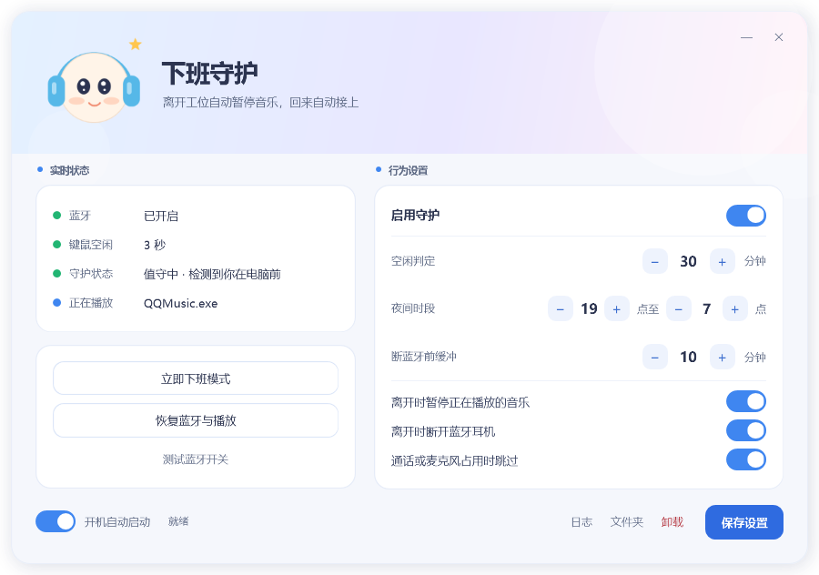

# BlueBye · 下班守护

**简体中文** · [English](README.en.md)



> 离开工位自动暂停播放并断开蓝牙耳机，回来自动接上。Windows 10/11，纯 PowerShell + WPF，无第三方依赖。

BlueBye pauses whatever is playing and switches the Bluetooth radio off once you have really left your desk, then puts both back as soon as you touch the keyboard or mouse. No console window, no drivers, no third-party packages.

离开工位后自动**暂停播放**并**断开蓝牙耳机**，回到座位一动鼠标/键盘就**自动把蓝牙开回来**。

解决的问题：下班走了，耳机还连着电脑、音乐还在放，播放器一直向系统申请「阻止睡眠」，
耳机整晚在解码 + 功放 + ANC 上耗电，第二天上班就是没电。

---

## 环境要求

- Windows 10 / 11（用到 `Windows.Devices.Radios` 与系统媒体会话，Win10 1809+ 均可）
- PowerShell 5.1（系统自带）
- .NET Framework 4.x（安装时用它把守护器编译成无控制台 exe）

不需要管理员权限：安装只写 `%LOCALAPPDATA%`、当前用户的计划任务和桌面快捷方式。

## 项目结构

| 路径 | 说明 |
| --- | --- |
| `away-guard-lib.ps1` | 引擎：配置、空闲检测、WinRT 蓝牙、媒体会话、状态机、宿主循环 |
| `away-guard.ps1` | 命令行入口（`Host` / `Tick` / `Status` / `Night` / `Restore` / `Resume` / `Probe` / `Test` / `Ensure`） |
| `away-guard-ui.ps1` | WPF 设置界面：无边框圆角窗口、浅色卡片、Q 版吉祥物 |
| `install.ps1` | 安装：编译守护器、生成图标与吉祥物、注册两个计划任务、创建桌面快捷方式 |
| `uninstall.ps1` | 卸载：停任务、删快捷方式与程序目录 |
| `make-mascot.ps1` | 用 GDI+ 画界面里的吉祥物（安装时自动生成） |
| `dev/` | 开发辅助：`check.ps1` 语法检查、`e2e-test.ps1` 端到端测试、`inspect-ui.ps1` 界面自检、`set-bom.ps1` 补 BOM |
| `docs/` | 截图 |

## 安装了什么

| 位置 | 内容 |
| --- | --- |
| `%LOCALAPPDATA%\AwayGuard` | 程序目录（脚本、配置、日志） |
| 桌面「下班守护」快捷方式 | 打开设置界面 |
| `AwayGuardSupervisor.exe` | 无控制台的守护器：托管 PowerShell 宿主，宿主退出后 5 秒内自动重启 |
| 计划任务 `AwayGuard-Host` | 登录时启动守护器（隐藏窗口、无控制台） |
| 计划任务 `AwayGuard-Watchdog` | 每 20 分钟检查「进程在 + 心跳新鲜」，两者缺一就重启 |

后台是「守护器 exe → PowerShell 宿主」两层：exe 没有控制台（避免被控制台事件杀死），宿主负责每 10 秒检查一次状态并写心跳；心跳超过 3 个周期没更新，看门狗会强制重启，不会出现「进程还在、其实已经卡死」。

---

## 它到底怎么判断「你走了」

**唯一的判定信号是键鼠空闲时长**，不看你几点打卡：

1. 当前时间在「夜间时段」内（默认 19:00 到次日 07:00）；
2. 键鼠空闲达到「空闲判定」（默认 30 分钟）；
3. 没有正在进行的通话（媒体会话不可暂停 / 麦克风被占用 → 跳过）；
4. 没接蓝牙键盘鼠标（避免把输入设备一起断掉）。

满足后：

- 第一步：暂停正在播放的播放器（QQ音乐、Chrome 等，走系统媒体会话，不会误启动没在放的东西）；
- 第二步：再等「关蓝牙延迟」（默认 10 分钟）。这段缓冲是给你留的后悔时间——如果你只是看了 30 分钟视频没动鼠标，
  音乐会以「暂停」的形式提醒你，你一动它就取消后续动作；
- 第三步：关闭蓝牙无线电 → 耳机看到断连，自动关机/休眠，整晚不再耗电。

回到座位：任意键鼠输入 → 10 秒内蓝牙自动打开，耳机自动重连。

> 只恢复「守护自己暂停过」的播放器，不会把你手动暂停的标签页放出来。

---

## 设置界面

双击桌面「下班守护」。界面是浅色的可爱风：顶部渐变横幅配一只戴蓝牙耳机的 Q 版小守护，下面是白色的「实时状态」和「行为设置」两块卡片。

- **实时状态**：蓝牙当前状态、键鼠空闲多久、守护在做什么、正在播放什么（蓝/绿/琥珀/红四种状态点）
- **空闲判定**：多少分钟没操作算离开（步进器调整）
- **夜间时段**：几点到几点之间才允许执行（防止白天午休被误判；两个数相同表示永不执行）
- **断蓝牙前缓冲**：暂停播放后等多久再断蓝牙
- **开关**：离开时暂停音乐 / 离开时断开蓝牙 / 通话或麦克风占用时跳过 / 启用守护
- **立即下班模式**：现在就走，立刻暂停 + 断蓝牙
- **恢复蓝牙与播放**：立刻开回蓝牙并恢复播放
- **测试蓝牙**：真断一次再连回来（约 5 秒），用来确认开关链路正常
- **开机自动启动守护**：控制那两个计划任务是否启用

窗口无边框，按住顶部横幅可拖动，右上角是最小化和关闭。键盘 Tab 会显示蓝色焦点环。

点「保存设置」后 40 秒内生效（后台守护每 30 秒重新读一次配置 + 最多 10 秒一个检查周期）。

---

## 配置文件

`%LOCALAPPDATA%\AwayGuard\config.json`

| 键 | 默认 | 说明 |
| --- | --- | --- |
| `Enabled` | `true` | 总开关，`false` 时只上报状态不执行动作 |
| `NightStartHour` | `19` | 夜间时段起始小时 |
| `NightEndHour` | `7` | 夜间时段结束小时（跨午夜） |
| `IdleMinutes` | `30` | 键鼠空闲多少分钟判定离开 |
| `RadioOffDelayMinutes` | `10` | 暂停后再等多少分钟断蓝牙，`0` 表示立即断 |
| `RestoreIdleSeconds` | `60` | 空闲低于多少秒算「人回来了」 |
| `PauseMedia` | `true` | 离开时暂停播放 |
| `TurnOffBluetooth` | `true` | 离开时关闭蓝牙无线电 |
| `SkipOnCallSession` | `true` | 有不可暂停的媒体会话（通话）时跳过 |
| `SkipWhenMicInUse` | `true` | 麦克风被占用时跳过 |
| `TickSeconds` | `10` | 后台检查间隔 |
| `DebugLog` | `false` | 打开后每次检查都写日志（排查用） |

改完直接保存即可，不用重启。

---

## 命令行（可选）

```powershell
$exe = "$env:LOCALAPPDATA\AwayGuard\away-guard.ps1"
powershell -NoProfile -ExecutionPolicy Bypass -File $exe -Mode Status    # 当前状态 + 最近日志
powershell -NoProfile -ExecutionPolicy Bypass -File $exe -Mode Probe     # 蓝牙授权、媒体会话、麦克风等诊断
powershell -NoProfile -ExecutionPolicy Bypass -File $exe -Mode Night     # 立即下班模式
powershell -NoProfile -ExecutionPolicy Bypass -File $exe -Mode Restore   # 立即恢复蓝牙
powershell -NoProfile -ExecutionPolicy Bypass -File $exe -Mode Resume    # 恢复我们暂停过的播放器
powershell -NoProfile -ExecutionPolicy Bypass -File $exe -Mode Ensure    # 守护没跑就拉起来
```

日志：`%LOCALAPPDATA%\AwayGuard\guard.log`（超过 1 MB 自动轮转，界面里也能直接打开）。

---

## 卸载

界面右下角「卸载」，或者：

```powershell
powershell -NoProfile -ExecutionPolicy Bypass -File "$env:LOCALAPPDATA\AwayGuard\uninstall.ps1"
```

会停止守护、删除两个计划任务、桌面快捷方式和程序目录。

---

## 常见问题

**为什么不用「让电脑睡眠」？**
睡眠确实能一石二鸟，但播放器会向系统申请「阻止睡眠」，光设睡眠时间不一定生效；
而且如果你有通宵运行的编译/下载，睡眠会把它们挂起。所以这里做的是**针对性**处理：只动耳机，不动电脑。
（顺带一提：这台机器插电时的睡眠时间目前是「永不」，如果你也希望它晚上休眠，是可以另外改的。）

**耳机第二天为什么是关机状态？**
蓝牙被关掉后耳机断连，几秒钟后自行关机——这正是目的。早上蓝牙自动开回来，你说一声它就重连。

**会影响蓝牙鼠标/键盘吗？**
判定是保守的：只要当前连着**一个以上**蓝牙设备（耳机之外还有鼠标/键盘），就只暂停播放、不关无线电。
不过这个判断依赖系统能列出蓝牙设备；如果你以后主要用蓝牙键鼠，建议直接把「离开时断开蓝牙耳机」关掉，最稳妥。

**「立即下班模式」和自动流程的检查一样吗？**
一样会先看有没有额外的蓝牙设备；另外它不做「通话中跳过」（因为是你主动点的）。

**我晚上看电影被暂停了怎么办？**
判定只看键鼠空闲，看了 30 分钟没动鼠标就会被当成「离开」。动一下鼠标即可恢复，
并且 10 分钟的「关蓝牙延迟」就是留给你在这种情况下取消的窗口。
觉得太敏感就把「空闲判定」调大，或者把「夜间时段」起始时间往后挪。

**守护进程还在跑吗？**
界面「守护状态」显示「值守中」就是正常。三种异常分别对应不同的修法：

- 「守护进程未运行」：看门狗最多 20 分钟会把它拉起来，也可以重新登录；
- 「守护无响应（心跳已停）」：进程在但卡住了（例如蓝牙驱动不返回），看门狗检测到心跳过期会强制重启；
- 「已暂停（总开关关闭）」：把「启用守护」打开并保存即可。

**会不会把蓝牙耳机永久留在关闭状态？**
不会。恢复判定不再依赖「当时读到的是关闭」，只要记录显示是我们关的、并且你回来了（或有键鼠输入），就会尝试开回蓝牙；适配器临时掉线（读成 Missing）也会在恢复时重试。另外还有 24 小时兜底：超过一天一定尝试恢复一次。
